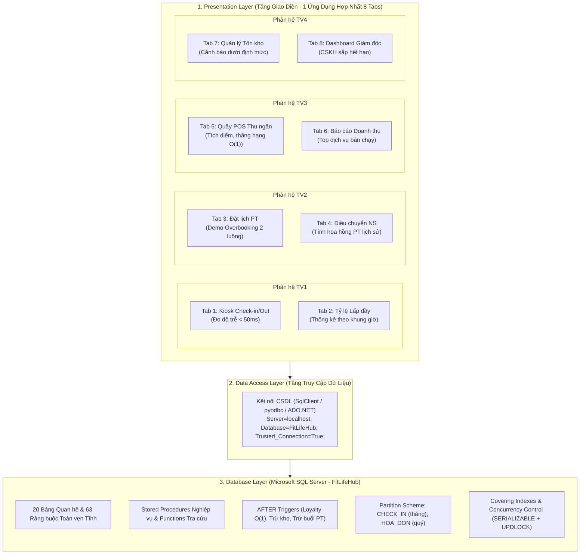

# App Demo - Hệ thống Quản lý Phòng tập FitLife Hub

Thư mục này chứa mã nguồn và tài liệu hướng dẫn cho ứng dụng minh họa (Demo Application) của hệ thống **FitLife Hub** phục vụ đánh giá đồ án môn **Cơ sở dữ liệu nâng cao (CSC12002)**.

---


## 1. Kiến trúc tổng thể hệ thống

Ứng dụng được xây dựng theo kiến trúc phân tầng (**N-tier Architecture**), trong đó toàn bộ nghiệp vụ, ràng buộc toàn vẹn và kiểm soát đồng thời được cài đặt trực tiếp tại tầng CSDL (**Microsoft SQL Server**):



---

## 2. Phân chia 4 Module & 8 Tab chức năng theo thành viên

Hệ thống được chia thành 4 module độc lập, mỗi thành viên chịu trách nhiệm cài đặt và demo module tương ứng với vấn đề nghiệp vụ mình phụ trách:

### Module 1: Check-in & Báo cáo Lấp đầy (`tv1_checkin_app/`)
* **Thành viên phụ trách:**
* **Giao diện chức năng:**
  1. **Tab 1: Màn hình Cổng kiểm soát (Kiosk Check-in):**
     * Nhập/quét Mã hội viên (`MaHV`) và Mã chi nhánh (`MaCN`).
     * Gọi Stored Procedure `dbo.sp_XuLyCheckIn` hoặc `dbo.sp_XuLyCheckOut`.
     * Hiển thị thời gian phản hồi thực tế (Latency đo bằng mili-giây) chứng minh mục tiêu **< 50ms**.
     * Hiển thị thông báo trạng thái: `Hợp lệ` (mở cửa) hoặc `Từ chối` (kèm lý do: hết hạn gói, gói không đúng chi nhánh, hết buổi tập).
  2. **Tab 2: Màn hình Báo cáo Lấp đầy (Occupancy Dashboard):**
     * Chọn Chi nhánh và Khoảng ngày cần thống kê.
     * Gọi Stored Procedure `dbo.sp_ThongKeTyLeLapDay`.
     * Hiển thị biểu đồ/bảng số lượt check-in theo từng khung giờ (Sáng, Trưa, Cao điểm, Tối) và tính % lấp đầy phòng tập.

---

### Module 2: Quản lý Lịch hẹn PT & Điều chuyển Nhân sự (`tv2_pt_app/`)
* **Thành viên phụ trách:**
* **Giao diện chức năng:**
  1. **Tab 3: Màn hình Đặt lịch Huấn luyện viên (PT Booking):**
     * Chọn Hội viên (`MaHV`), Huấn luyện viên (`MaNV`), Gói PT (`MaDK`), Thời gian bắt đầu và Thời gian kết thúc.
     * Gọi Stored Procedure `dbo.sp_DatLichPT`.
     * Nút **Demo Concurrent Booking (Mô phỏng Overbooking):** Kích hoạt 2 luồng (threads) đồng thời gửi yêu cầu đặt lịch cùng một HLV tại cùng khung giờ.
     * Kết quả hiển thị: Luồng 1 thành công (COMMIT), Luồng 2 bị chặn/từ chối do xung đột (ROLLBACK theo RBTV07/RBTV08).
     * Nút **Xác nhận hoàn thành buổi tập:** Gọi `dbo.sp_HoanThanhBuoiPT` để kích hoạt Trigger tự động trừ `SoBuoiConLai` trên `DANG_KY_GOI`.
  2. **Tab 4: Màn hình Điều chuyển Nhân sự & Tính hoa hồng:**
     * Form điều chuyển: Chọn Nhân viên (`MaNV`), Chi nhánh mới (`MaCNMoi`), Chức vụ mới, Lương mới và Ngày chuyển -> Gọi `dbo.sp_DieuChuyenNhanSu`.
     * Tra cứu & Tính hoa hồng: Chọn Huấn luyện viên và Tháng/Năm -> Gọi `dbo.sp_TinhLuongHoaHongPT` để phân bổ hoa hồng đúng chi nhánh tại thời điểm dạy.

---

### Module 3: Quản lý Hội viên, Tích điểm & Hóa đơn (`tv3_member_app/`)
* **Thành viên phụ trách:**
* **Giao diện chức năng:**
  1. **Tab 5: Quầy Thu Ngân & Thanh toán O(1) (POS Checkout):**
     * Chọn Hội viên, hiển thị sẵn Hạng hiện tại (`MaHang`), Điểm tích lũy (`DiemTichLuy`), Tổng chi tiêu năm (`TongChiTieuNam`).
     * Thêm Gói dịch vụ hoặc Sản phẩm bán lẻ vào giỏ hàng -> Gọi `dbo.sp_TaoHoaDon`.
     * Xác nhận thanh toán -> Gọi `dbo.sp_ThanhToanHoaDon` (Tiền mặt / VNPay / Thẻ).
     * Khi cập nhật `TrangThaiTT = N'Thành công'`, Trigger `trg_CapNhatThanhToan_Va_Loyalty` tự động kích hoạt:
       * Tích lũy điểm (1 điểm / 100.000 VNĐ).
       * Tăng tổng chi tiêu năm.
       * Cập nhật hạng thành viên tức thời theo độ phức tạp **$O(1)$** (nhảy hạng Silver -> Gold -> Platinum trực tiếp trên màn hình).
  2. **Tab 6: Báo cáo Doanh thu & Top Dịch vụ:**
     * Bộ lọc Chi nhánh và Khoảng thời gian -> Gọi `dbo.sp_BaoCaoDoanhThu` hiển thị biểu đồ doanh thu theo Ngày/Tháng/Quý.
     * Thống kê Top N gói dịch vụ/sản phẩm có doanh thu cao nhất 6 tháng gần nhất -> Gọi `dbo.sp_TopGoiDichVuBanChay`.

---

### Module 4: Quản lý Tồn kho & Thống kê Doanh thu (`tv4_inventory_app/`)
* **Thành viên phụ trách:**
* **Giao diện chức năng:**
  1. **Tab 7: Màn hình Quản lý Tồn kho (Inventory Management):**
     * Xem danh sách tồn kho từng sản phẩm theo từng chi nhánh (`TON_KHO`).
     * Tự động tô đỏ (cảnh báo) các sản phẩm có `SoLuongTon <= MucTonToiThieu` -> Gọi `dbo.sp_BaoCaoTonKho`.
     * Chức năng **Giao dịch kho:** Thực hiện Nhập hàng hoặc Điều chỉnh -> Gọi `dbo.sp_GiaoDichKho` (Trigger `trg_CapNhatTonKho` tự động cập nhật tồn kho an toàn, không âm).
  2. **Tab 8: Dashboard Giám đốc & CSKH:**
     * Biểu đồ tỷ lệ phân bổ hạng hội viên (`Silver` / `Gold` / `Platinum`) trên toàn hệ thống -> Gọi `dbo.sp_ThongKePhanBoHangHoiVien`.
     * Danh sách hội viên sắp hết hạn gói tập trong N ngày tới hoặc không đi tập trong 30 ngày qua để CSKH liên hệ -> Gọi `dbo.sp_ThongKeHoiVienSapHetHan`.

---

## 3. Hướng dẫn thiết lập & Chạy ứng dụng

### Yêu cầu môi trường
* Hệ điều hành: Windows 10/11
* Hệ quản trị CSDL: Microsoft SQL Server 2019 hoặc mới hơn (đã bật SQL Server Authentication hoặc Windows Authentication)
* Ngôn ngữ đề xuất cho nhóm:
  * **Phương án 1 (Python Streamlit - Khuyên dùng vì nhanh nhất):** Cài đặt `pip install streamlit pyodbc pandas plotly`. TV4 dựng file `app.py` với `st.sidebar` hoặc `st.tabs` chia 8 Tabs, mỗi bạn code 1 file component riêng.
  * **Phương án 2 (C# WinForms / WPF):** Sử dụng Visual Studio với `TabControl` gồm 8 Tabs, kết nối qua `Microsoft.Data.SqlClient`.

### Các bước khởi chạy
1. **Khởi tạo CSDL:** Mở SQL Server Management Studio (SSMS), mở và chạy tuần tự 2 file:
   * `Database_Scripts/01_Create_Schema.sql` (Tạo bảng và 63 RBTV tĩnh)
   * `Database_Scripts/02_Seed_Data.sql` (Sinh dữ liệu mẫu $\ge 70.000$ dòng/bảng)
2. **Cài đặt các Module tối ưu:** Chạy tiếp các file từ `03_VanDe1_CheckIn.sql` đến `08_Kho_Va_ThongKe.sql`.
3. **Cấu hình Connection String:**
   ```
   Server=localhost;Database=FitLifeHub;Trusted_Connection=True;TrustServerCertificate=True;
   ```
4. **Chạy ứng dụng:** Mở terminal và chạy lệnh khởi động ứng dụng chính để trải nghiệm toàn bộ 8 Tab chức năng.
